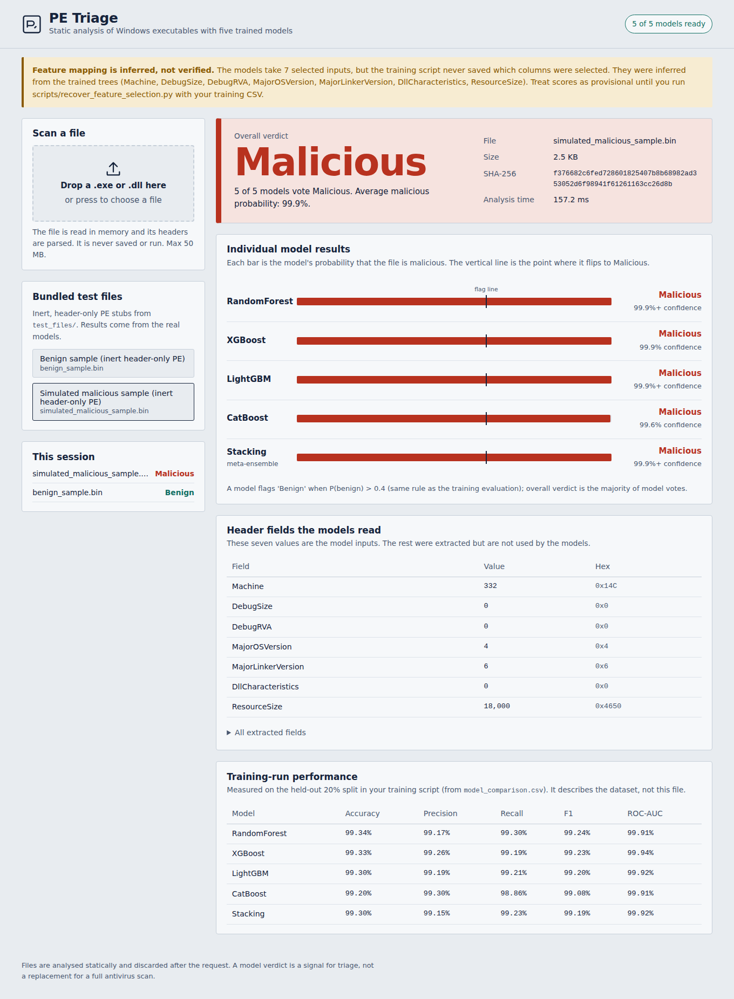

# PE Triage: malware detection dashboard

A FastAPI backend and single-page dashboard that scores Windows executables (PE files) with your five trained models:
**RandomForest, XGBoost, LightGBM, CatBoost and a Stacking ensemble**. Upload a file, get an overall Malicious/Benign verdict,
each model's result and confidence, and the header fields that drove it.



## Read this first: one open issue

Your training script reduces ~20 columns to **7** with `SelectFromModel`, but it never saved that selector and the training CSV
(`data_file (3).csv`) was not provided. So the models contain no column names, only "7 numbers in a fixed order".

I recovered the most likely mapping from the trained trees (e.g. `Machine` splits at exactly (0x14C+0x8664)/2 = 17368, `DebugSize` splits at
multiples of 28, `DllCharacteristics` splits at bitmask values) and cross-checked it on real benign Windows binaries (all five models agree they are benign):

```
Machine, DebugSize, DebugRVA, MajorOSVersion, MajorLinkerVersion, DllCharacteristics, ResourceSize
```

This is **inferred, not verified**. `models/feature_selection.json` therefore says `"status": "inferred"`, every API response carries that status,
and the dashboard shows a banner. To make it exact, run this once with your original CSV:

```bash
python scripts/recover_feature_selection.py --csv "data_file (3).csv" --verify
```

It replays your exact preprocessing (seed 42, same split, SMOTE, selector), rewrites `feature_selection.json` as `"verified"`, and with `--verify`
re-scores the held-out split and prints accuracy next to your `model_comparison.csv` numbers so you can confirm they match. If the selected count is not 7 it aborts without touching anything.

Other facts taken from your script and applied here: class `1` = **Benign** (target column is `Benign`); a model flags Benign when P(benign) > **0.4**
(your evaluation threshold); the pickles were written with **scikit-learn 1.7.1**, which is pinned in `requirements.txt`.

## Setup

Python 3.10+ (tested on 3.12).

```bash
python -m venv .venv && source .venv/bin/activate      # Windows: .venv\Scripts\activate
pip install -r requirements.txt
./run.sh                                               # or: uvicorn app.main:app --port 8000
```

Open http://127.0.0.1:8000. The first start takes ~10 s while the 130 MB of model files load.

| Env var | Default | Meaning |
|---|---|---|
| `MAX_UPLOAD_MB` | 50 | Upload size limit |
| `RATE_LIMIT_PER_MIN` | 30 | Scan requests per IP per minute |
| `HOST` / `PORT` | 127.0.0.1 / 8000 | Used by `run.sh` |

## How it works

```
upload ─► size cap, in-memory only ─► pefile header parse ─► 20 features (15 raw + 5 engineered, same formulas as training)
       ─► pick the 7 selected columns ─► 5 models predict_proba ─► rule: Benign if P(benign) > 0.4 ─► majority vote
```

* `app/pe_features.py`: static feature extraction (`Machine`, `DebugSize`, `DllCharacteristics`, `ResourceSize`, Bitcoin-address count, …) and the
  engineered columns from `feature_engineering()`.
* `app/model_service.py`: loads each pickle once, validates its input width, returns per-model label and probabilities.
* `app/main.py`: API, security middleware, static hosting. `app/static/`: the dashboard.
* The SMOTE step in training only affected the training set, so nothing about it is needed at inference. The selector is applied through `feature_selection.json`.

**Non-PE files get no prediction.** The models only know PE header features, so scripts, documents, ELF or Mach-O files are rejected with a clear message rather than scored with made-up numbers.

### API

| Method & path | Purpose |
|---|---|
| `POST /api/scan` | multipart field `file`. Returns verdict, votes, per-model label/P(malicious)/P(benign), extracted features, SHA-256 |
| `POST /api/scan-sample/{name}` | scan one of the two whitelisted files in `test_files/` |
| `GET /api/models` | model list, inputs, threshold, training-run metrics |
| `GET /api/health` | which models loaded |

Errors are always `{"error": {"code": "...", "message": "..."}}`: `NOT_A_PE_FILE` (422), `EMPTY_FILE`/`BAD_REQUEST` (400), `TOO_LARGE` (413), `RATE_LIMITED` (429), `INTERNAL_ERROR` (500, with a reference id; details only in server logs).

## Security notes

* Uploads are never executed, imported or written to disk; only header fields are parsed (`pefile`, `fast_load`).
* Size cap enforced both from `Content-Length` and while streaming; per-IP rate limit on scan endpoints; filenames sanitised; the UI inserts all text with `textContent` (no `innerHTML`).
* Strict CSP (`script-src 'self'`), `X-Frame-Options: DENY`, `nosniff`, `no-referrer`, `no-store` on API responses, no CORS, no public OpenAPI docs.
* **Pickle warning:** `joblib.load` can execute code. Only load model files you produced or trust. Do not expose a way to replace them.
* The built-in rate limiter is per-process and memory-based. Behind a reverse proxy, add TLS, auth and a real limiter before exposing this publicly.

## Tests

```bash
python scripts/run_tests.py          # real API + real models; writes TEST_RESULTS.md and tests_output/test_results.json
```

Latest results are in [`TEST_RESULTS.md`](TEST_RESULTS.md):

| File | Verdict | Votes | Mean P(malicious) |
|---|---|---|---|
| `test_files/benign_sample.bin` | Benign | 0 mal / 5 ben | 0.120 |
| `test_files/simulated_malicious_sample.bin` | Malicious | 5 mal / 0 ben | 0.999 |

The two test files are **inert, header-only PE stubs** made by `scripts/make_test_files.py` (no code, `.bin` extension). They prove the pipeline works with real model outputs.
They are **not** a measure of accuracy: the malicious stub's header profile was chosen after probing the models, and it is not real malware. Your held-out metrics
(≈99.2–99.3 % accuracy, `reference/tables/model_comparison.csv`) are the accuracy evidence, and they describe the dataset you trained on.

## Limitations

* Header-only features: packed or deliberately crafted PE files can look benign or malicious regardless of behaviour. This is triage, not a replacement for antivirus or sandboxing.
* The dataset's feature definitions (e.g. which data directory `IatVRA` refers to, how `BitcoinAddresses` was counted) are reconstructed from column names. They only matter if the selected columns include them; the inferred 7 do not.
* Confidence values are model probabilities and may be overconfident (the 99.9 % scores on out-of-distribution files should not be read as certainty).

## Project layout

```
app/            backend (main.py, model_service.py, pe_features.py) + static/ dashboard
models/         your 5 .pkl files + feature_selection.json
reference/      your training metrics and confusion-matrix plots
scripts/        make_test_files.py, recover_feature_selection.py, run_tests.py, original_training_script.py
test_files/     the two inert samples
docs/screenshots/  UI screenshots   ·   TEST_RESULTS.md, tests_output/  test output
```
